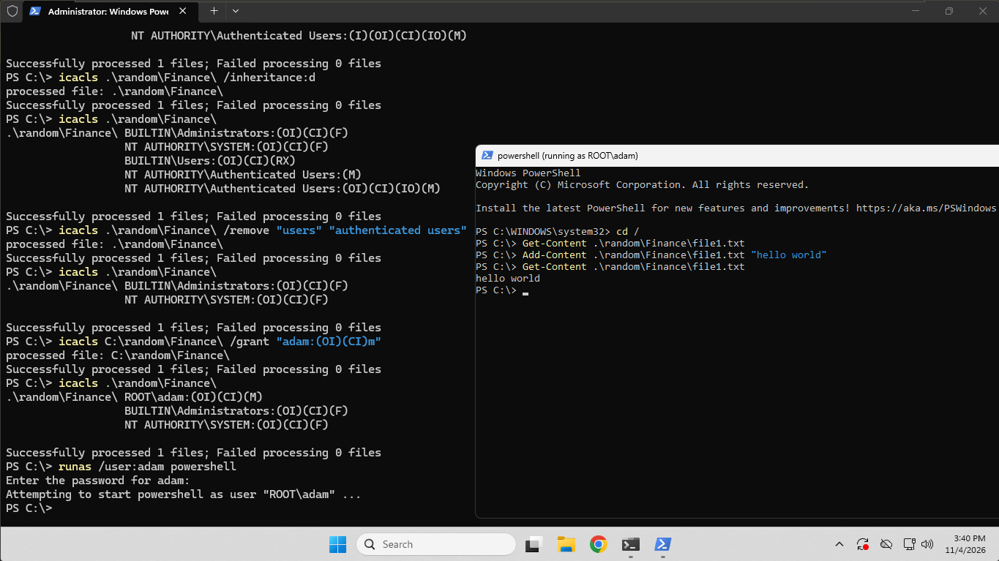
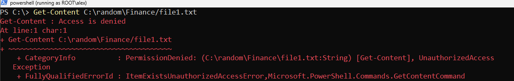
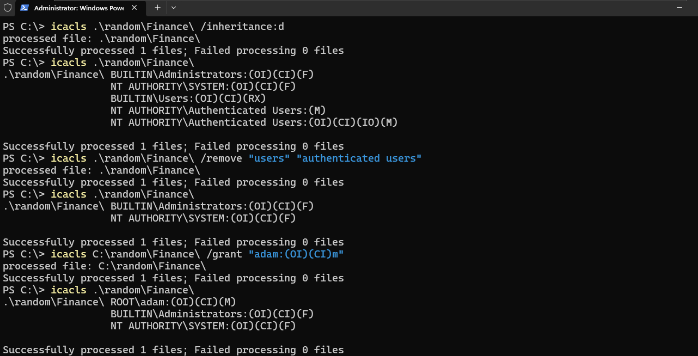

# Windows NTFS Permissions with icacls

## Objective
Restrict a folder to a single user using `icacls`, then verify that other users are denied and that permission levels (Modify vs Read) behave differently.

---

## Environment
- VMware workstation pro
- Windows 11 Pro
- PowerShell (run as Administrator)
- Users from my [Windows Local User & Group Management](link-to-your-repo) project: `adam` (granted access), `alex` (no access)

---

## Steps
### Setup
1. Created the folder `C:\random\Finance` with a test file `file1.txt`.
2. Viewed the default permissions (all inherited from the parent).

### Locking down the folder
1. Disabled inheritance, keeping the inherited entries as explicit ones.
2. Removed the general `Users` and `Authenticated Users` entries.
3. Granted `adam` Modify, applied to subfolders and files.
4. Viewed the permissions again to confirm the change.

### Testing
1. As `adam` (Modify): read and edited the file successfully.
2. As `alex` (no permission): access denied.
3. Changed `adam` to Read with `/grant:r`: read worked, edit was denied.

---

## Commands Used
```powershell
mkdir random/Finance
new-item .\random\Finance\file1.txt
```
```powershell
icacls C:\random\Finance\
```
```powershell
icacls .\random\Finance\ /inheritance:d
```
```powershell
icacls .\random\Finance\ /remove "users" "authenticated users"
```
```powershell
icacls C:\random\Finance\ /grant "adam:(OI)(CI)m"
```
```powershell
runas /user:adam powershell
```
```powershell
icacls .\random\Finance\ /grant:r "adam:(OI)(CI)r"
```

---

## Permissions Output
**Before** (every entry is inherited, shown by `(I)`):
```
C:\random\Finance\ BUILTIN\Administrators:(I)(OI)(CI)(F)
                   NT AUTHORITY\SYSTEM:(I)(OI)(CI)(F)
                   BUILTIN\Users:(I)(OI)(CI)(RX)
                   NT AUTHORITY\Authenticated Users:(I)(M)
                   NT AUTHORITY\Authenticated Users:(I)(OI)(CI)(IO)(M)
```

**After** (adam has Modify, general Users access removed):
```
.\random\Finance\ ROOT\adam:(OI)(CI)(M)
                  BUILTIN\Administrators:(OI)(CI)(F)
                  NT AUTHORITY\SYSTEM:(OI)(CI)(F)
```

**After changing adam to Read:**
```
.\random\Finance\ ROOT\adam:(OI)(CI)(R)
                  BUILTIN\Administrators:(OI)(CI)(F)
                  NT AUTHORITY\SYSTEM:(OI)(CI)(F)
```

---

## Test Results
| User | Permission | Read | Edit |
|------|-----------|------|------|
| adam | Modify | ✅ | ✅ |
| adam | Read | ✅ | ❌ |
| alex | None | ❌ | ❌ |

---

## Why Inheritance Was Disabled
By default the folder inherits permissions from its parent, including broad entries like `Users`, which can't be removed from the child while inheritance is on. Disabling it makes the folder independent, so only the intended access remains.

---

## Skills Practiced
- NTFS permission management with `icacls`
- Inheritance, `(OI)(CI)` flags, and permission levels (F, M, RX, R)
- Testing access as different users with `runas`
- Verifying changes before and after

## What I Learned
- Disabling inheritance is what makes it possible to remove inherited entries like `Users`.
- `/grant` adds permissions, while `/grant:r` replaces existing ones.
- `(OI)(CI)` applies a permission to files and subfolders inside the folder.
- Least privilege: grant only the access needed, only to who needs it.
- Testing as each user is the only real proof that permissions work.

---

## Screenshots
**adam (Modify): can read and edit**



**alex (no permission): access denied**



**adam (Read): can read, edit denied**


